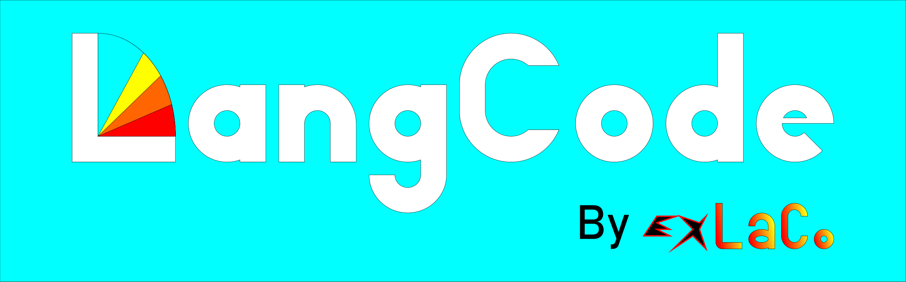

<div align="center">
  

  <h1>LangCode IDE — Программируй на родном языке!</h1>

  <p>
    <b>Мультиязычная среда разработки и умный транспилятор для школьников, новичков и учителей.</b><br>
    Пиши код привычными словами на родном языке — получай чистые стандартные файлы Python, Lua, JavaScript, HTML и CSS.
  </p>

  <p>
    
    
    
    
  </p>
</div>

---

## О проекте

Главная преграда при старте в программировании — языковой барьер. Новичкам приходится одновременно изучать логику алгоритмов и запоминать незнакомые английские слова.

**LangCode IDE** решает эту проблему:
* **Понятный старт:** Вы пишете код привычными словами на русском языке (`.rupy`, `.rulua`, `.rujs`, `.ruhtml`, `.rucss`).
* **Безопасность исходников:** При сохранении программа оставляет ваш оригинальный файл нетронутым и автоматически создает рядом стандартный английский файл (`.py`, `.lua`, `.js`, `.html`, `.css`).
* **Полное ядро Python (~195 команд):** Поддерживаются все ключевые слова, встроенные функции, типы данных и исключения чистого Python.
* **Умный переводчик ошибок:** Если программа вылетает при запуске, IDE переводит название системной ошибки на русский язык и выводит понятную подсказку, как ее исправить.

---

## Поддерживаемые языки (v0.2.0)

| Технология | Входной файл | Выходной файл | Где применяется |
| :--- | :--- | :--- | :--- |
| **Python** | `.rupy` | `.py` | Скрипты, боты, задачи, нейросети |
| **Lua** | `.rulua` | `.lua` | Разработка игр и скриптов в **Roblox Studio** |
| **JavaScript** | `.rujs` | `.js` | Логика и интерактивность для сайтов |
| **HTML** | `.ruhtml` | `.html` | Структура веб-страниц |
| **CSS** | `.rucss` | `.css` | Дизайн, цвета и оформление сайтов |

### Пример работы (Python)

**Вы пишете (`привет.rupy`):**
```python
имя = ввод("Как тебя зовут? ")
если имя == "ExLaCo":
    печать("Привет, создатель LangCode!")
иначе:
    печать("Добро пожаловать в LangCode,", имя)
```

**IDE автоматически создает (`привет.py`):**
```python
имя = input("Как тебя зовут? ")
if имя == "ExLaCo":
    print("Привет, создатель LangCode!")
else:
    print("Добро пожаловать в LangCode,", имя)
```

---

## Как запустить программу (v0.2.0)

1. Убедитесь, что на компьютере установлен **Python 3.8** или новее.
2. Скачайте файл `LangCodeV0.2.0.py` из этого репозитория.
3. Запустите его двойным кликом или через терминал:
   ```bash
   python LangCodeV0.2.0.py
   ```
4. Напишите свой первый код и нажмите **«▶ Запустить (F5)»**!

---

## Планы развития (Roadmap)

* [x] **v0.0.1** — Темная тема интерфейса, скругленные кнопки, базовый перевод Python, JS, HTML и CSS.
* [x] **v0.1.0** — Добавлена поддержка языка **Lua** (для Roblox) и кнопка «Новый».
* [x] **v0.2.0** — Полное ядро Python (~195 команд) и умный переводчик ошибок на русский язык с подсказками.
* [ ] **v0.3.0** — Подсветка синтаксиса, нумерация строк и автоотступы.
* [ ] **v1.0.0** — Сборка единого `.exe` установщика для Windows, экран загрузки (Splash Screen) и режим *School Edition* для школ.
* [ ] **v2.0.0** — Встроенная кнопка «📖 Справка» с примерами и перевод библиотек (`turtle`, `random`).
* [ ] **v3.0.0** — Модульные JSON-словари и выход на международный уровень (испанский, португальский, немецкий, китайский, казахский, татарский, якутский и другие языки мира).
* [ ] **v4.0.0+** — Веб-версия **LangCode Lite** в браузере, магазин расширений **LangCode Shop** и помощник **LangCode AI**.

---

## Лаборатория Experimental LangCode (EXLangCode)

Мы развиваем проект открыто и рады новым участникам! Вы можете помочь проекту тремя способами:
1. **Предложить идею или сообщить об ошибке** — откройте вкладку **Issues** (Ящик предложений) и опишите свою задумку.
2. **Перевести словари** — помогите добавить ваш родной язык (от испанского и якутского до языка эмодзи).
3. **Написать код** — сделайте **Fork** репозитория, добавьте новую функцию и отправьте **Pull Request**.

> **Приглашение в студию:** Авторы лучших идей, переводчики и разработчики получают приглашение в закрытую волонтерскую лабораторию **Experimental LangCode (EXLangCode)** и доступ к экспериментальной сборке **EXLangCode IDE**!

---

## Поддержать проект

Если вам понравилась идея **LangCode IDE**, поставьте **звездочку (Star ⭐)** в правом верхнем углу этой страницы!
